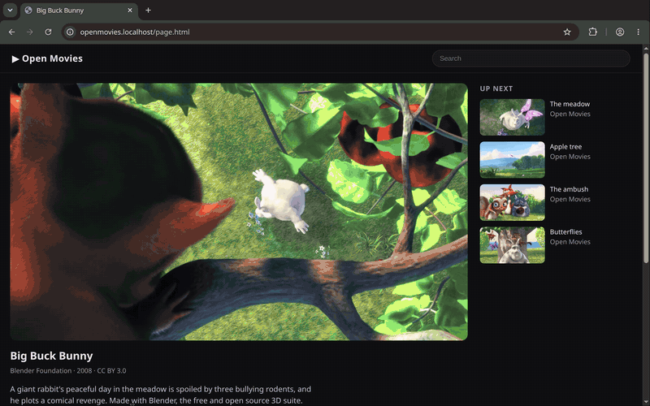
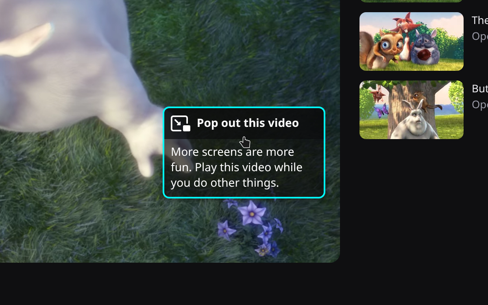
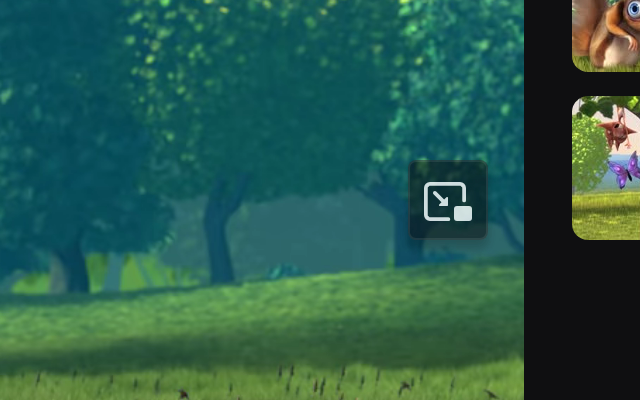

#  Hover PiP

A Picture-in-Picture button for Chromium browsers, ported from Firefox's toggle.
Hover a video and the toggle appears on its right edge, as in Firefox. Click it
to pop the video out; elements under the toggle never see the click (page-level
capture listeners still observe an event targeted at the extension's overlay).
**Alt+P** toggles PiP on the most prominent video. Rebind it at
`chrome://extensions/shortcuts`.



Like Firefox, the toggle shows only on videos at least 45 seconds long and
140×140 px. It starts as the "Pop out this video" pill and switches to the
compact icon after the first use.

 

Needs Chromium 153 or later; tested on 153, 154 and 156.

## Install

1. Open `chrome://extensions` and turn on **Developer mode**.
2. Click **Load unpacked** and pick the `extension/` directory.

Tabs that are already open get the toggle right away, after an install or an
update.

## Differences from Firefox

- The toggle also works on videos that set `disablePictureInPicture`. Firefox
  respects that attribute by default; this extension deliberately does not.
- No toggle when a `<video>` element itself is fullscreen (players that make a
  container fullscreen are fine). Use **Alt+P** or Chromium's own video controls
  there.

## Develop

```sh
npm install
npx playwright install chromium
npm test            # unit tests (node:test)
npm run test:e2e    # Playwright, headed under xvfb-run; needs ffmpeg, Xvfb, uv
npm run test:smoke  # live sites (YouTube, Vimeo, Twitch, Commons, Internet Archive)
```

CI runs `npm test` and `npm run test:e2e` on every pull request; `main` only
takes pull requests that pass. The smoke tests stay out of CI, since live sites
change and many block datacenter IPs. They use `/usr/bin/chromium`, which has
the proprietary codecs Playwright's Chromium lacks; set `CHROMIUM_PATH` for
another build.

Before a release, also check by hand what automation can't reach: a signed-in
DRM site (Netflix, Disney+ or Prime Video), Reddit and X feeds, a site with a
cookie or consent wall, and Edge and Brave as well as Chromium.

`npm run test:e2e` clears `test-results/` before each run. To compare the toggle
with Firefox's own, screenshot both into `test-results/parity/`:

```sh
npx playwright install firefox
env -u WAYLAND_DISPLAY xvfb-run -a node test/visual/parity.js
```

## Demo media

`media/` holds the README demo and Chrome Web Store assets, all from one
scripted recording: a real X pointer hovers a video on `scripts/demo/page.html`,
opens Picture-in-Picture from the toggle and browses on, while ffmpeg grabs the
whole Xvfb screen, PiP window and cursor included. To regenerate (needs ffmpeg,
Xvfb, uv, ImageMagick; the first run downloads the footage):

```sh
npm run demo         # records test-results/demo/raw.mkv
npm run demo:media   # media/demo.mp4, demo.gif, toggle zooms, media/store/
```

`media/store/` has five 1280×800 screenshots and a 440×280 small promo tile;
`media/demo.mp4` is 1280×800 too.

The icon's source is `media/icon.svg`. After editing it, `npm run icons`
renders `extension/icons/icon-{16,32,48,128}.png`.

## Release

1. In a pull request, bump the version: `npm run bump -- patch` (or `minor`,
   `major`, or an exact `x.y.z`).
2. After it merges, run `npm run package` on `main`. It checks that every file
   the manifest names exists and writes `dist/hover-pip-<version>.zip`, the
   extension plus `LICENSE`, ready to upload to the Chrome Web Store.

CI builds the same zip on every run, runs the e2e suite against its unzipped
contents, and keeps it as the `hover-pip-extension` artifact for 30 days.

## Credits

The toggle's styles, markup, icon, strings, and hover behaviour are ported from
Firefox 156 (`pipToggle.css`, `videocontrols.js`, `PictureInPictureChild.sys.mjs`,
`picture-in-picture-open.svg`), © Mozilla, under the
[Mozilla Public License 2.0](https://mozilla.org/MPL/2.0/). Verbatim copies are
in `vendor/firefox-156.0.1/`. This project is MPL-2.0 too.

The demo footage is from [Big Buck Bunny](https://peach.blender.org/), © 2008
Blender Foundation, under [CC BY 3.0](https://creativecommons.org/licenses/by/3.0/).
